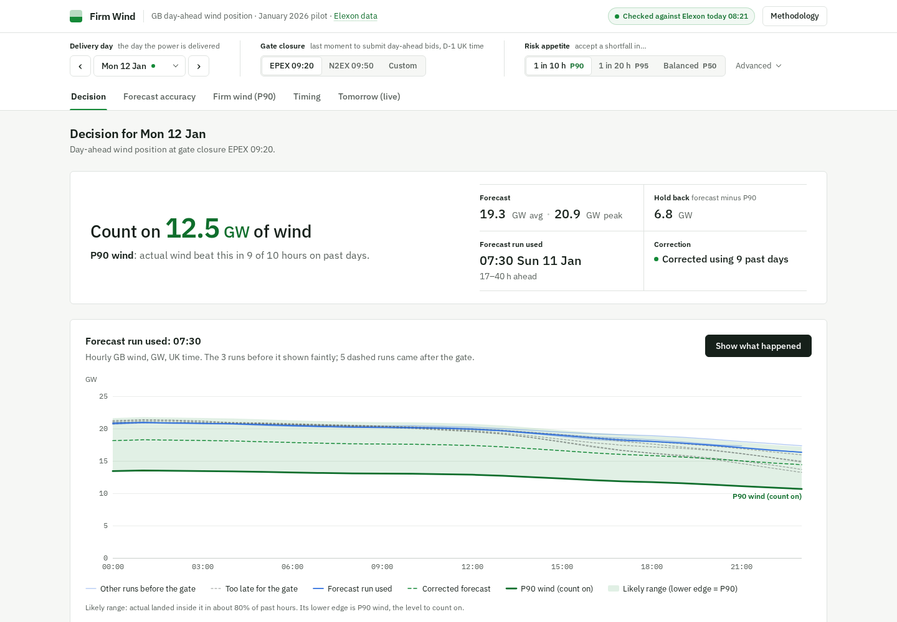

# Firm Wind

[](https://github.com/MrKuros/blk62s/actions/workflows/ci.yml)

Firm Wind is a decision desk for a UK day-ahead power buyer. When an auction closes, the buyer needs to know how much national wind they can count on and how sure they can be. The app replays every January 2026 purchase decision using only the forecasts published before gate closure. It then measures how wrong the public NESO wind forecast (Elexon WINDFOR) was against metered output (Elexon FUELHH). Finally it turns that error into a single **P90 wind** number (the level actual generation beat in 9 of 10 hours, at a reliability the buyer can change), and tests that number on days the model had not yet seen. The main finding is that WINDFOR consistently over-states actual generation, and the gap widens as wind rises. A correction learned only from earlier days removes much of that gap.

**Live app:** https://blk62s.vercel.app · **API docs:** https://blk62s.vercel.app/api/docs · **Architecture:** [`docs/ARCHITECTURE.md`](docs/ARCHITECTURE.md)



## What it answers

| Question                      | Tab               | What you see                                                                                                                                                                                                                                                                                                                                                                                                                                                             |
| ----------------------------- | ----------------- | ------------------------------------------------------------------------------------------------------------------------------------------------------------------------------------------------------------------------------------------------------------------------------------------------------------------------------------------------------------------------------------------------------------------------------------------------------------------------ |
| What did we know at the gate? | Decision          | Pick any delivery day (2 Jan to 1 Feb). The answer hero at the top gives the P90 wind and hold back (forecast minus P90). The chart shows the forecast run available before gate closure, as raw and corrected forecast lines with an uncertainty band; "Show what happened" then draws actual generation (outturn). A Why panel lists signals generated from the numbers by deterministic templates, and a gate timeline shows every forecast run from D-2 to delivery. |
| How good is the forecast?     | Forecast accuracy | Mean absolute error, forecast bias (forecast minus actual, positive = too high) and error as a share of actual generation, each with a bootstrap confidence interval, and the corrected forecast's error next to the raw one. A chart shows how the error grows with forecast level, and a daily error calendar opens any day in Decision.                                                                                                                               |
| How much can I count on?      | Firm wind (P90)   | P90 wind at a chosen shortfall frequency (1 in 10 by default), and shortfall energy vs P90 plan (national GWh). A reliability chart compares target with achieved coverage per hour and per whole day. Every number is tested walk-forward.                                                                                                                                                                                                                              |
| When should we decide?        | Timing            | Mean absolute error for every forecast run slot from D-2 02:30 to D-1 22:30, on like-for-like hours, with the EPEX and N2EX gate closures marked. Also shows the difference between the two auctions.                                                                                                                                                                                                                                                                    |
| What about tomorrow?          | Tomorrow (live)   | The same pipeline on live Elexon data: the latest forecast run for tomorrow, corrected and banded, with calibration from the trailing 30 days. This is a preview beyond the January pilot.                                                                                                                                                                                                                                                                               |

A receipt panel in the methodology drawer (cutoff, run used, source, data hash, version) also heads every CSV export; the footer carries the data hash and version.

## Repository layout

| Path                                         | What it is                                                                                                                                                                                        |
| -------------------------------------------- | ------------------------------------------------------------------------------------------------------------------------------------------------------------------------------------------------- |
| `backend/`                                   | FastAPI service (Python 3.12, managed with uv). Vercel deploys it as a single Python function.                                                                                                    |
| `backend/main.py`                            | Routes under `/api/v1`, error shape, cache headers, request logging. Vercel entrypoint `main:app`.                                                                                                |
| `backend/app/data.py`                        | Elexon fetch, normalisation, data hash, snapshot load, background live verification, live inputs for the Tomorrow (live) tab.                                                                     |
| `backend/app/analysis.py`                    | Pure pandas/numpy functions with no I/O: cutoffs and DST, cleaning, alignment, decision run, metrics, block bootstrap, walk-forward correction, firm-wind quantiles, value of waiting, baselines. |
| `backend/app/signals.py`                     | Rules for the Why panel signals. Each returns `{id, params}`, and the frontend renders the sentence.                                                                                              |
| `backend/app/service.py`                     | Builds each API view from the analysis (cached), plus the CSV export rows.                                                                                                                        |
| `backend/app/schemas.py`                     | Pydantic response models: the API contract the frontend types are generated from.                                                                                                                 |
| `backend/data/snapshot.json.gz`              | Bundled Elexon snapshot (WINDFOR Nov 30 to Feb 1, FUELHH Dec 1 to Feb 1), columnar and hashed.                                                                                                    |
| `backend/tests/`                             | pytest suite: unit, no-lookahead property, API contract and golden-output tests, with contract fixtures and frozen golden JSON.                                                                   |
| `backend/Dockerfile`                         | API image (python:3.12-slim + uv, uvicorn on port 8000).                                                                                                                                          |
| `frontend/`                                  | React 19 + TypeScript + Vite single-page app (pnpm).                                                                                                                                              |
| `frontend/src/sections/`                     | One component per tab: Decision, Forecast accuracy, Firm wind (P90), Timing, Tomorrow (live).                                                                                                     |
| `frontend/src/charts/`                       | Hand-built SVG charts on a shared frame (d3-scale and d3-shape only).                                                                                                                             |
| `frontend/src/components/`                   | Top bar, tabs, answer hero, day picker, KPI tiles, Why panel notes, source badge, methodology drawer, loading and error states.                                                                   |
| `frontend/src/hooks/`                        | `useUrlState` (the URL is the single source of UI state) and TanStack Query hooks keyed on the data hash.                                                                                         |
| `frontend/src/lib/`                          | API client, client-side firm-wind maths (checked for parity against Python), formatters, signal text, generated OpenAPI types.                                                                    |
| `frontend/src/styles/`                       | Design tokens and app styles.                                                                                                                                                                     |
| `frontend/Dockerfile`, `frontend/nginx.conf` | Multi-stage build: the Vite build is served by nginx on port 8080, which proxies `/api` to the API container.                                                                                     |
| `scripts/refresh_snapshot.py`                | Refetches the Elexon ranges, sanity-checks them and rewrites the snapshot. It is never run at request time.                                                                                       |
| `scripts/story_numbers.py`                   | Prints the headline numbers at the app defaults, so they can be checked against the UI and the golden output.                                                                                     |
| `docs/METHODOLOGY.md`                        | How the analysis works and why: timeline, data semantics, metrics, validation, limitations.                                                                                                       |
| `docs/ARCHITECTURE.md`                       | Reviewer guide to how the system is built: diagrams, request lifecycle, API contract, caching, failure modes, tests, design trade-offs, where to start reading.                                   |
| `docs/research/`                             | Pre-build investigations: auction timing, Elexon dataset semantics, exploratory January analysis (with runnable scripts) and the final numbers.                                                   |
| `docker-compose.yml`                         | Local stack: `api` + `web`.                                                                                                                                                                       |
| `vercel.json`                                | Vercel Services config: `web` (Vite) and `api` (FastAPI) on one domain, region `lhr1`.                                                                                                            |
| `.github/workflows/ci.yml`                   | Lint, type-check, test and build for both apps, with contract drift checks and a Docker build on `main`.                                                                                          |

## Quick start

### Docker (closest to production)

```bash
docker compose up --build
```

Open <http://localhost:8080>. The API is proxied at <http://localhost:8080/api/docs>.

### Local development

Requires [uv](https://docs.astral.sh/uv/) and pnpm, through Corepack or a standalone install (version pinned in `frontend/package.json`).

```bash
# API on :8000
cd backend
uv sync
uv run uvicorn main:app --reload --port 8000

# Web on :5173 (Vite proxies /api to :8000)
cd frontend
pnpm install
pnpm dev
```

Useful extras:

```bash
uv run --project backend python scripts/story_numbers.py      # headline numbers at the defaults
uv run --project backend python scripts/refresh_snapshot.py   # refetch Elexon and rewrite the snapshot

# After changing backend/app/schemas.py, regenerate the frontend contract:
cd backend && uv run python -c "import json, main; print(json.dumps(main.app.openapi(), indent=2, sort_keys=True))" \
  2>/dev/null > ../frontend/src/lib/openapi.json && cd ../frontend && pnpm gen:api
```

### Why both Docker and Vercel?

Vercel does not run these containers. It builds `frontend/` as a static Vite site and `backend/` as a Python function from the same source, and routes `/api/*` to the function (`vercel.json`). Docker Compose gives a reviewer a one-command local stack with the same same-origin `/api` layout. Both read the same bundled snapshot.

## API overview

Interactive docs: `/api/docs` (OpenAPI JSON at `/api/openapi.json`). Times in payloads are UTC ISO-8601; the UI shows UK local time.

| Endpoint                                              | Returns                                                                                                                                                                                   |
| ----------------------------------------------------- | ----------------------------------------------------------------------------------------------------------------------------------------------------------------------------------------- |
| `GET /api/v1/meta`                                    | Delivery days, auction presets, latency margins, publish slots, data hash, version, live source status                                                                                    |
| `GET /api/v1/replay?day&cutoff&margin&calib`          | Decision run (raw and corrected), other runs flagged too-late, band and quantile grid, actual generation, KPIs, EPEX vs N2EX comparison, headline signal and the other signals that fired |
| `GET /api/v1/accuracy?cutoff&margin&calib`            | Headline metrics with CIs, raw vs corrected, error by forecast level, per-day errors, alignment sensitivity, baselines                                                                    |
| `GET /api/v1/firm?cutoff&margin&calib`                | Per-day raw, corrected, actual and walk-forward quantile grid (the client computes firm wind and coverage), plus the firm-method comparison                                               |
| `GET /api/v1/waiting`                                 | Mean absolute error per publish slot on common hours, gates, paired gains                                                                                                                 |
| `GET /api/v1/live?cutoff&margin`                      | Tomorrow (live) tab: latest run for tomorrow with trailing-30-day calibration, or an explicit `unavailable` status                                                                        |
| `GET /api/v1/export.csv?view&cutoff&margin&calib&day` | CSV with receipt comment lines first                                                                                                                                                      |
| `GET /api/v1/health`                                  | Liveness, version, data hash, source status                                                                                                                                               |

Parameters: `cutoff` = `epex` \| `n2ex` \| `HH:MM` (UK local, D-1); `margin` = `0` \| `10` \| `20` \| `60` minutes (the API accepts any multiple of 10 up to 60); `calib` = `jan` \| `dec`; `day` = a delivery day from `meta.days`. The client also sends `v=<data hash>`, which the server ignores, to key the CDN cache. Invalid parameters return HTTP 422 with `{"error": {"code", "message", "field"}}`. The deterministic views are CDN-cached for a day. `meta` and `live` get short TTLs that depend on their state, and `health` is `no-store`.

## Key assumptions

| Assumption               | Choice                                                                                                                             | Why                                                                                                                                                                                                                                                             |
| ------------------------ | ---------------------------------------------------------------------------------------------------------------------------------- | --------------------------------------------------------------------------------------------------------------------------------------------------------------------------------------------------------------------------------------------------------------- |
| Decision time            | **EPEX 09:20** (default) or **N2EX 09:50**, UK local on D-1, plus a custom time                                                    | These are GB's two hourly day-ahead auctions, and EPEX closes first. Gate times are converted in Europe/London, so DST is handled.                                                                                                                              |
| Which forecasts count    | Strictly `publishTime < gate`, optionally minus a 0/10/20/60 min latency margin                                                    | A run published at the gate cannot be used. The margin lets a buyer allow for a slow download; 60 min tests runs only being usable at Elexon's documented times. In January the EPEX gate uses the 07:30 run; N2EX gets the 09:30 run, 20 minutes before close. |
| Delivery days            | 2 Jan to 1 Feb 2026 (31 days)                                                                                                      | These are the deliveries whose purchase decisions were made in January.                                                                                                                                                                                         |
| Hindcast rows            | WINDFOR rows with `startTime < publishTime` dropped                                                                                | Each run repeats 5 to 25 hours of the past. They are not actuals and could never inform a decision.                                                                                                                                                             |
| Alignment                | Hourly forecast at _h_ vs the mean of FUELHH half-hours _h_ and _h+30m_                                                            | This is the energy of the hourly product being traded. It was chosen before looking at results; two alternatives appear in a sensitivity table.                                                                                                                 |
| Correction and firm wind | Walk-forward: day D is calibrated only on delivery days ≤ D-2                                                                      | D-1's outturn is not complete at the D-1 gate. Nothing about day D is fitted on D or later.                                                                                                                                                                     |
| Calibration window       | January only (default; 5 training days needed, so the first 6 deliveries, 2–7 Jan, are warm-up) or "Include December 2025 history" | The toggle uses history a trader really held at the time. Warm-up days show the raw forecast and are left out of coverage statistics.                                                                                                                           |
| Data source              | Bundled snapshot is primary, verified live against Elexon via `/api/v1/source` (CDN-cached)                                        | Historic data does not change, so review-day outages cannot change the numbers. The badge shows _verified_, _changed_ or _unreachable_.                                                                                                                         |

The full reasoning, including caveats such as curtailment, the 28 Jan NESO IT incident and why the NESO benchmark is not comparable, is in [`docs/METHODOLOGY.md`](docs/METHODOLOGY.md).

For how the system is built (data flow, caching, API contract, failure modes, tests and design trade-offs), see [`docs/ARCHITECTURE.md`](docs/ARCHITECTURE.md).

## Testing and CI

```bash
cd backend  && uv run ruff check . && uv run ruff format --check . && uv run pytest -q
cd frontend && pnpm format:check && pnpm lint && pnpm typecheck && pnpm test --run && pnpm build
cd frontend && pnpm test:e2e   # Playwright smoke tests on a production build; starts the API and a preview server if needed
```

- **No-lookahead property test.** For every delivery day, both auctions, custom cutoffs and every latency margin, it checks three things: only runs published before the cutoff are used, training stops at D-2, and persistence and ceiling values use only FUELHH rows published before the cutoff. It then doubles every value published after the cutoff and asserts the replay is unchanged.
- **Unit tests.** Cutoff strictness and DST (29 Mar and 25 Oct), 23- and 25-hour days, hindcast drop, alignment, walk-forward coverage on synthetic data, warm-up, block-bootstrap determinism, common-hours rule, the off-schedule 12:25 run, every signal rule, and degraded data-source paths.
- **Contract and golden tests.** Every route is checked against its response model, along with 422s, cache headers and the CSV receipt. The views are frozen as golden JSON (`UPDATE_GOLDEN=1` regenerates them along with the parity fixture for the client-side firm-wind maths).
- **Frontend tests.** Vitest covers URL state, formatters, firm-wind maths (parity with Python within 1e-9), signal text, the gate timeline, live refresh timing and the charts. Playwright smoke tests drive the built app against the real API.
- **CI** (`.github/workflows/ci.yml`) runs all of the above. It fails if the backend OpenAPI schema or the generated TypeScript types drift from what is committed, and it builds both Docker images on `main`.

## Use of AI tools

This project was built with **Claude Code (Anthropic)** as a pair-programming assistant. It helped with domain and data research (Elexon dataset semantics, auction timings, exploratory analysis of the January data), with implementing the backend, frontend, tests and infrastructure, and with code review. I directed the product and analysis decisions, including the decision times, the walk-forward validation, the firm-wind method and the scope. I reviewed all of the code and checked the results against the data and the test suite.
