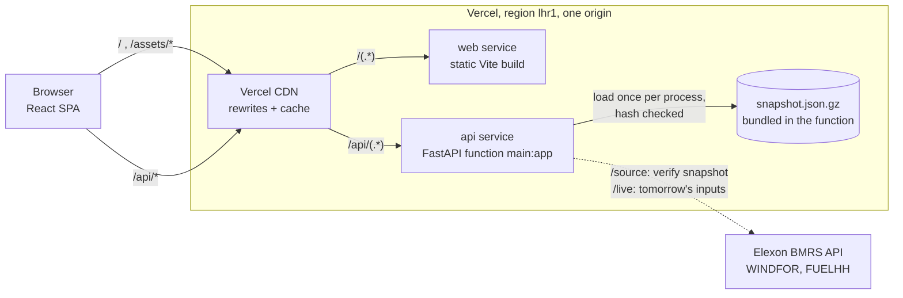
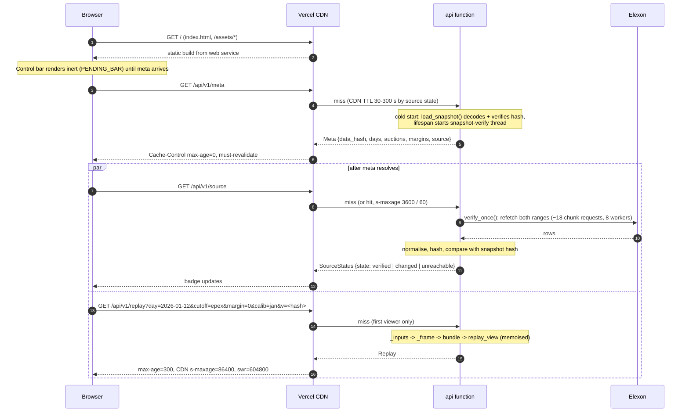
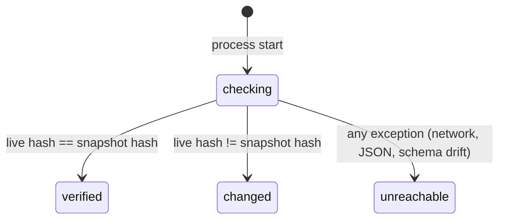
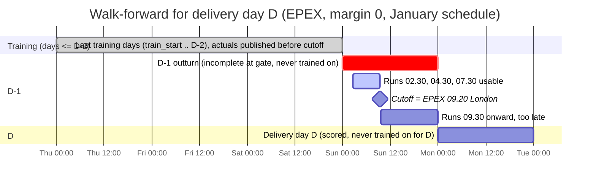

# Architecture

This document is for an engineer reviewing or auditing Firm Wind. It covers how the system is built, why it is built that way, and where it is weak. [README.md](../README.md) covers what the app does and how to run it. [METHODOLOGY.md](METHODOLOGY.md) covers the statistical reasoning. This document does not repeat either beyond what it needs.

Code references use relative links. Line numbers are given only where they are stable and help; they may drift.

---

## 1. Purpose and scope

Firm Wind answers two questions for a GB day-ahead power buyer:

1. **Replay:** for each delivery day decided in January 2026, what was knowable about national wind at gate closure, and how did it turn out?
2. **Firm wind:** how much wind can the buyer count on, at a chosen reliability, and does that number hold on days the model had not seen?

A Tomorrow (live) tab runs the same pipeline on live data as a preview. It is outside the pilot and is built so the pilot never depends on it.

### Domain terms

| Term                 | Meaning in this codebase                                                                                                                                                                  |
| -------------------- | ----------------------------------------------------------------------------------------------------------------------------------------------------------------------------------------- |
| **Delivery day (D)** | A Europe/London local day, 00:00 to 24:00. It has 23, 24 or 25 hours ([`analysis.delivery_hours`](../backend/app/analysis.py)).                                                           |
| **Gate closure**     | The auction deadline on D-1, London local time: EPEX 09:20 or N2EX 09:50 (`AUCTIONS`), or a custom `HH:MM`.                                                                               |
| **Cutoff**           | Gate closure converted to UTC, minus an optional latency margin of 0 to 60 minutes. Only data published strictly before the cutoff may inform day D.                                      |
| **Run**              | One WINDFOR forecast, identified by its `publishTime`. In January there were eight a day.                                                                                                 |
| **Decision run**     | The latest run with `publishTime < cutoff`.                                                                                                                                               |
| **Outturn / actual** | Metered wind output from FUELHH (`fuelType=WIND`), half-hourly.                                                                                                                           |
| **Hindcast row**     | A WINDFOR row whose `startTime` is before its own `publishTime`. These rows are dropped.                                                                                                  |
| **Error**            | `actual - forecast`. A negative error means the forecast was too high. The UI flips this to "forecast bias = forecast - actual" ([`format.overForecast`](../frontend/src/lib/format.ts)). |
| **P90 / firm wind**  | The level that actual generation exceeded in about 90% of hours: `max(0, corrected * q[r-1])` with `r = 10`. More generally Pxx with `xx = 100 - r`, `r` from 1 to 50.                    |
| **Walk-forward**     | Each day D is fitted only on delivery days up to D-2, using only actuals published before D's cutoff.                                                                                     |

### Data limits

- Two Elexon BMRS datasets only: `WINDFOR` (NESO national wind forecast) and `FUELHH` (metered generation by fuel type).
- Bundled snapshot: WINDFOR runs published from 2025-11-30 00:00Z to 2026-02-01 00:00Z, FUELHH settlement dates from 2025-12-01 to 2026-02-01 inclusive ([`data.py`](../backend/app/data.py), `WINDFOR_RANGE`, `FUELHH_RANGE`). The current file holds 36,792 WINDFOR rows and 3,024 FUELHH rows (63 days of 48 half-hours).
- Pilot delivery days: 2 Jan to 1 Feb 2026 (31 days, `DAYS`). These are the days whose decisions were made in January. December data is needed for the first January days (their D-2 runs, the D-2 baseline and slots, and persistence) and for the optional "Include December history" calibration.
- 28 Jan 2026 is a known NESO IT failure day (`EXCLUDED_DAY`). It is shown, flagged, and can be excluded from firm-wind coverage.

---

## 2. System overview



- **Two services, one origin.** [`vercel.json`](../vercel.json) defines `web` (built from `frontend/`, framework `vite`) and `api` (built from `backend/`, framework `fastapi`, entrypoint `main:app`). Rewrites are tried in order: `/api/(.*)` goes to `api`, then `/(.*)` goes to `web`. Because everything is same-origin there is no CORS configuration.
- **FastAPI docs live under `/api`** (`docs_url="/api/docs"`, `openapi_url="/api/openapi.json"`, `redoc_url=None` in [`main.py`](../backend/main.py)) so the API rewrite reaches them.
- **The snapshot is the source of truth.** January views are pure functions of the bundled file. Elexon is contacted only to verify the snapshot (`/source`) and to serve the Tomorrow tab (`/live`). The dashed edges above are the only network dependencies, and both degrade without affecting the January views (section 9).
- `tests/**` is excluded from the function bundle (`excludeFiles` in `vercel.json`).

### Backend modules

| Module                                          | Role                                                                                                                                   | I/O                 |
| ----------------------------------------------- | -------------------------------------------------------------------------------------------------------------------------------------- | ------------------- |
| [`main.py`](../backend/main.py)                 | Routes, query validation, error shape, cache headers, request log, lifespan                                                            | HTTP                |
| [`app/service.py`](../backend/app/service.py)   | Builds each view model from the analysis; memoised; CSV rows                                                                           | none (calls `data`) |
| [`app/analysis.py`](../backend/app/analysis.py) | Pure pandas/numpy: time and DST, cleaning, alignment, run selection, walk-forward fit, quantiles, metrics, bootstrap, baselines, slots | none                |
| [`app/signals.py`](../backend/app/signals.py)   | Rule set for the "Why" panel; returns `{id, params}` only                                                                              | none                |
| [`app/data.py`](../backend/app/data.py)         | Elexon fetch, normalisation, hash, snapshot read/write, source verification, live inputs                                               | network, disk       |
| [`app/schemas.py`](../backend/app/schemas.py)   | Pydantic response models; the API contract                                                                                             | none                |

### Frontend layers

| Layer | Path                                                                                                                         | Role                                                          |
| ----- | ---------------------------------------------------------------------------------------------------------------------------- | ------------------------------------------------------------- |
| Entry | [`main.tsx`](../frontend/src/main.tsx), [`App.tsx`](../frontend/src/App.tsx)                                                 | QueryClient, fonts, shell, tab switch                         |
| State | [`hooks/useUrlState.ts`](../frontend/src/hooks/useUrlState.ts)                                                               | The URL query string is the only view state                   |
| Data  | [`hooks/queries.ts`](../frontend/src/hooks/queries.ts), [`lib/api.ts`](../frontend/src/lib/api.ts)                           | TanStack Query hooks keyed on the data hash; typed fetch      |
| Maths | [`lib/firm.ts`](../frontend/src/lib/firm.ts), [`lib/timeline.ts`](../frontend/src/lib/timeline.ts)                           | Client-side firm wind, coverage, reliability; gate timeline   |
| Text  | [`lib/signals.ts`](../frontend/src/lib/signals.ts), [`lib/format.ts`](../frontend/src/lib/format.ts)                         | Signal sentences, number and time formatting                  |
| Views | [`sections/`](../frontend/src/sections/), [`components/`](../frontend/src/components/), [`charts/`](../frontend/src/charts/) | One section per tab; shared components; hand-built SVG charts |

---

## 3. Request lifecycle

First load of `/?day=2026-01-12` on the Decision tab:



Points a reviewer should note:

- **Meta first.** Every January query needs `v = meta.data_hash` in its key and URL, and is `enabled: !!v` ([`queries.ts`](../frontend/src/hooks/queries.ts)). So meta is a hard dependency: if it fails, the app shows a full error state ([`App.tsx`](../frontend/src/App.tsx)).
- **`v=<hash>` is a CDN cache key, not a parameter.** The server declares `v` and ignores it (`CacheBust` in `main.py`). Because the hash is part of the URL, a new snapshot produces new URLs, so neither the CDN nor TanStack Query can serve stale January results across a data change. This is what makes the one-day CDN TTL with a week of stale-while-revalidate safe.
- **`/source` is fetched separately, after meta, and merged into meta** on the client. The check runs inline on `/source` because a serverless function is frozen once its response is sent, so a background thread cannot be relied on (`verify_once` docstring in `data.py`). Splitting it out lets the page render while the badge catches up.
- **Parameter changes** (gate, margin, calibration) change the query key, so they refetch. `keepPreviousData` keeps the old result on screen at reduced opacity while the new one loads. Risk (`r`) and the 28 Jan exclusion are computed on the client and never refetch.

---

## 4. Data layer

Source: [`backend/app/data.py`](../backend/app/data.py), [`scripts/refresh_snapshot.py`](../scripts/refresh_snapshot.py).

### Fetch

- Base URL `https://data.elexon.co.uk/bmrs/api/v1/datasets`, `/WINDFOR/stream` and `/FUELHH/stream` with `fuelType=WIND`.
- Ranges are split into 7-day chunks (`CHUNK_DAYS = 7`). WINDFOR chunks are on `publishDateTimeFrom/To`, with each window's end reused as the next start, so a publish exactly on a boundary can arrive twice; normalisation dedupes it. FUELHH chunks are 7 inclusive settlement dates.
- `_get_all` fetches chunks with `ThreadPoolExecutor(max_workers=8)` and `pool.map` (order preserved). The code's reason: a serverless request can afford about 5 s, not about 30 s. The two datasets are fetched one after the other.
- `_http_get`: 3 attempts, `User-Agent: firmwind/0.1`. Retries on 429, 5xx, `URLError` and `TimeoutError`, with backoff 1.5 s then 3 s. Any other 4xx raises immediately. The timeout is per request.

### Normalise

- `_frame` keeps exactly three columns: `publishTime`, `startTime` (both UTC) and `generation` (float MW). Other API fields are dropped.
- WINDFOR: dedupe on `(publishTime, startTime)` keeping the last row in arrival order, then sort.
- FUELHH: sort by `publishTime`, dedupe on `startTime` keeping the latest publish, then sort by `startTime`.
- Hindcast rows are kept here on purpose and dropped later by `analysis.clean_windfor`, so the snapshot stores what Elexon returned.

### Snapshot format and hash

- File: gzip of compact JSON `{meta, windfor, fuelhh}`, columnar integer arrays. Times are epoch seconds; generation is rounded to whole MW with `np.rint`. `gzip.compress(..., mtime=0)` makes the bytes deterministic.
- `meta` holds `fetched_at`, the two ranges, `hash` and row counts.
- Hash (`data_hash`): SHA-256 over compact JSON of the normalised columns, truncated to 12 hex characters. It hashes values, not file bytes, so a live refetch and the snapshot compare like for like.
- Refresh is manual: `uv run --project backend python scripts/refresh_snapshot.py`. It asserts no duplicate keys and no missing FUELHH half-hours, and prints (does not assert) runs per day and half-hours per London day.

### Load

- `load_snapshot()` is `lru_cache(maxsize=1)`: one decode per process. It recomputes the hash and raises `RuntimeError` on a mismatch, so a corrupted file fails every cold start rather than serving wrong numbers.
- `service._inputs()` (memoised) applies `clean_windfor` and returns `(windfor, fuelhh, hash, fetched_at)` to everything downstream.

### Source verification state machine



- `SOURCE = {"state", "checked_at"}` lives in the process and is read under `_lock`.
- `verify_now(timeout=20)` refetches both full ranges, normalises, hashes and compares. Every exception inside its `try` becomes `unreachable`.
- `verify_once(max_age_s=3600)` runs under a separate `_verify_lock` and reuses any result less than an hour old; otherwise it verifies inline. Concurrent `/source` callers in one process queue behind the lock and get the fresh result. `/meta` and the request logger only take `_lock`, so they never block on the network.
- `start_verify()` starts a daemon thread once per process from the FastAPI lifespan. On a long-lived server (Docker) it completes; on serverless it may not, which is why `/source` verifies inline. The thread and `/source` share `_verify_lock`, so an inline check can wait behind a running or frozen thread and inherit its result (including an `unreachable` recorded after a thaw, which `verify_once` then reuses for an hour).

### Live inputs (Tomorrow tab)

- `live_inputs(now, fresh_from)` fetches WINDFOR published from `now - 33 days` (floored to the hour) to `now + 1 h`, and FUELHH settlement dates from `now - 32 days` to today. These feed a trailing 30-day calibration (target-31 to target-2).
- Cache: module dict, `LIVE_TTL_S = 1800` for a good result, `LIVE_FAIL_TTL_S = 60` for a failure. A good cached value is returned only if it is younger than 30 min and, when `fresh_from` is given, was fetched at or after it. `service.live_view` passes `fresh_from = cutoff` once the gate has passed, because data fetched before the gate may lack the run the gate used.
- A failure discards the previous good value, stores the error, and re-raises it without fetching for 60 s.
- `live_inputs` has no lock of its own; `service._live_lock` serialises callers so the first one fetches (about 15 s cold) and the rest read its result.

---

## 5. Analysis pipeline

Source: [`backend/app/analysis.py`](../backend/app/analysis.py), orchestrated by [`backend/app/service.py`](../backend/app/service.py). The analysis module does no I/O; every function takes frames and returns frames or plain values. Timestamps are tz-aware UTC; days and cutoffs are defined in Europe/London.

### The central invariant: no lookahead

> Every input to D's decision (run used, correction, q, firm wind, persistence, ceiling, signals) is a function only of rows whose `publishTime` is strictly before D's cutoff.

The Decision view also shows data published after the cutoff on purpose, for comparison and scoring: the too-late runs and D's metered outturn. The outturn is in the `/replay` payload whether or not `reveal` is set.

This applies to forecasts (which run is used), to actuals (what the correction and quantiles are trained on), and to everything derived from them (persistence baseline, delivered-wind ceiling, frozen-feed detection, signals). It is enforced at four points and tested by perturbation (section 10).



### Steps

1. **Clean.** `clean_windfor` keeps rows with `startTime >= publishTime`. Each run restates up to about 25 hours before its own publish time; those rows are not forecasts and are dropped.
2. **Cutoff.** `parse_cutoff` maps `epex`/`n2ex` to 09:20/09:50 or parses a strict `HH:MM`. `cutoff_utc(day, local, margin_min)` builds that time on D-1 in `ZoneInfo("Europe/London")`, converts to UTC and subtracts the margin. DST is resolved per date in `analysis.local_utc`, which every London-time conversion goes through (cutoffs, delivery hours, training windows, slots).
3. **Hourly actuals with `known_at`.** `_hourly` aggregates FUELHH half-hours to hours. The default alignment `hour_mean` uses mean(HH[h], HH[h+30m]); `hh_start` and `centred` exist for a sensitivity table. A missing half-hour makes the hour NaN. Each hour also carries `known_at`, the latest `publishTime` of its half-hours. Timestamps are made naive so numpy's max propagates NaT alongside a NaN actual.
4. **Decision run selection (enforcement point 1).** `frame_for_cutoffs` uses `searchsorted(cut, side="left") - 1` on sorted publish times, which selects the latest run with `publishTime < cut` (strict). It then looks up that run's rows for D's delivery hours. Hours the run does not cover are dropped, not filled from an older run; a run published on D-2 covers only 22 of D's hours. Output columns: `day, startTime, publishTime, forecast, cutoff, actual, err, lead_h, known_at`. `service._frame` calls `decision_frame` over `HISTORY_DAYS` (63 days) so December rows exist; the alignment sensitivity frames in `accuracy_view` cover January only.
5. **Training rows (enforcement points 2 and 3).** `_train_rows` keeps rows with `startTime` from London 00:00 on `train_start` to London 00:00 on D-1, which is delivery days up to D-2, because D-1 actuals are not complete at the gate. It also requires a non-NaN actual and `known_at < cutoff(D)`, so an actual published late is excluded even if its day is old enough.
6. **Warm-up.** Fewer than 5 distinct training days (`WARMUP_MIN_DAYS`) means `calibrating=True`, no fit, and `corrected = forecast`. With `calib=jan` (training from 2 Jan) days 2 to 7 Jan are warm-up. Warm-up days are excluded from coverage statistics and corrected-error comparisons.
7. **Fit.** `np.polyfit(forecast, actual, 1)` gives `corrected = a + b * forecast`.
8. **Ratio quantiles.** `q = percentile(actual / corrected, 1..99)` over training hours with `corrected >= 500` MW (smaller corrected values make the ratio noise). `q[i]` is the P(i+1) percentile. Because the band is multiplicative, it scales with forecast level.
9. **Firm wind.** `firm = max(0, corrected * q[r-1])`, `r` in 1..50. P90 is `r = 10`. The server returns `corrected` and `q`; the browser computes firm wind (section 7).
10. **Derived, cutoff-bounded values (enforcement point 4).** `persistence(fh, cut)` is the latest half-hour published before the cutoff, held flat. `ceiling_known` is the maximum hourly actual since `train_start` among FUELHH rows published before the cutoff (None while the cutoff is under 5 days after London 00:00 on `train_start`; for calib=jan that is delivery days 2 to 7 Jan, the same days as the fit warm-up). `unchanged_runs(wf, pub)` counts consecutive runs ending at the decision run whose overlapping values all differ by less than 1 MW; it walks backwards only from a run already chosen before the cutoff.

### Evaluation

- **Coverage** (`coverage`, `_cov`): over non-calibrating, non-excluded hours with an actual, the share of hours with `actual >= firm`, the share of days where every hour held, shortfall GWh, and firm share of raw forecast. It is out of sample because each day's `q` comes only from days up to D-2.
- **Metrics:** MAE, bias, RMSE and WAPE (`sum|e| / sum actual`). `day_sums` reduces rows to per-day sufficient statistics so a bootstrap resample is a row sum.
- **Block bootstrap:** moving (non-circular) blocks of 3 days, 2000 resamples, fixed seed 20260101, 90% interval. Paired differences use the same indices on both sides and require identical day indexes. The code's reason for blocks: errors are strongly autocorrelated within and across neighbouring days.
- **Method comparison** (`method_table`): ratio (the UI method), additive residual quantile, and additive per forecast-level bin with fallback to pooled when a bin has fewer than 30 training hours; each at `r` 10 and 5, with and without 28 Jan.
- **Value of waiting** (`slot_frames`, `common_hours`): 16 nominal slots (D-2 and D-1 at the eight run times), each with a 59-minute grace so the late 12:25 run on 15 Jan lands in its 11:30 slot. All slots and both gate runs are scored on the intersection of hours they all cover. Gate runs come from the real decision frames, not slots, because a slot's grace reaches past the gate.
- **Baselines:** persistence (above) and the D-2 run at the same clock time, on the hours it covers.

### Signals

[`signals.py`](../backend/app/signals.py) returns `{id, params}`; the frontend writes the sentence ([`lib/signals.ts`](../frontend/src/lib/signals.ts)). Priority, first match is the headline:

| Order | id              | Fires when                                                                                                                                                                                         |
| ----- | --------------- | -------------------------------------------------------------------------------------------------------------------------------------------------------------------------------------------------- |
| 1     | `run_jump`      | The decision run repeats at least the 2 runs before it (`STALE_RUNS = 3`): the feed stopped updating. Outranks everything because every other number is then stale. 28 Jan is the motivating case. |
| 2     | `above_ceiling` | At least one hour's raw forecast exceeds the delivered-wind ceiling known at the cutoff.                                                                                                           |
| 3     | `revision`      | Mean of (decision run - previous run) over shared hours has magnitude >= 1000 MW. Two-sided.                                                                                                       |
| 4     | `correction`    | Mean of (forecast - corrected) >= 1000 MW. One-sided; skipped while calibrating.                                                                                                                   |
| 5     | `calibrating`   | The day is in warm-up.                                                                                                                                                                             |

---

## 6. API contract

Source: [`backend/main.py`](../backend/main.py), [`backend/app/schemas.py`](../backend/app/schemas.py). All routes are `GET` under `/api/v1`. Swagger UI: `/api/docs`; schema: `/api/openapi.json`.

### Parameters

| Param    | Type and validation                                                                                                                                                     | Default             |
| -------- | ----------------------------------------------------------------------------------------------------------------------------------------------------------------------- | ------------------- |
| `cutoff` | `^(epex\|n2ex\|([01]\d\|2[0-3]):[0-5]\d)$`; custom time is D-1 London local                                                                                             | `epex`              |
| `margin` | int, `0 <= m <= 60`, multiple of 10. An int rather than a `Literal` because query strings arrive as text and a `Literal` of ints rejects `"10"` (comment in `main.py`). | `0`                 |
| `calib`  | `jan` (train from 2 Jan) or `dec` (from 1 Dec)                                                                                                                          | `jan`               |
| `day`    | ISO date, must be in `DAYS`, else 422 via `ParamError`                                                                                                                  | required where used |
| `v`      | string, ignored by the server; CDN cache key                                                                                                                            | none                |

### Routes

| Path          | Params                                                                                          | Cache policy                                                                                                  | Purpose                                                                                                                                                                                             |
| ------------- | ----------------------------------------------------------------------------------------------- | ------------------------------------------------------------------------------------------------------------- | --------------------------------------------------------------------------------------------------------------------------------------------------------------------------------------------------- |
| `/meta`       | none                                                                                            | browser `max-age=0, must-revalidate`; CDN `s-maxage` 30 (checking), 300 (verified, changed), 60 (unreachable) | Version, data hash, snapshot time, source state, days, auctions, margins `[0,10,20,60]`, slots, excluded day                                                                                        |
| `/source`     | none                                                                                            | browser revalidate; CDN 3600 when verified or changed, else 60                                                | Snapshot check against live Elexon, inline, at most once an hour per process                                                                                                                        |
| `/replay`     | `day`, `cutoff`, `margin`, `calib`, `v`                                                         | `STATIC`                                                                                                      | One decision day: decision run, hours (raw, corrected, actual), all runs published D-2 00:00 to D-1 23:59 London, flagged `too_late`, calibration and `q`, KPIs, signals, persistence, EPEX vs N2EX |
| `/accuracy`   | `cutoff`, `margin`, `calib`, `v`                                                                | `STATIC`                                                                                                      | Headline metrics with CIs, raw vs corrected (paired), by level, per day, alignment sensitivity, baselines                                                                                           |
| `/firm`       | `cutoff`, `margin`, `calib`, `v`                                                                | `STATIC`                                                                                                      | Per-day raw, corrected, actual and `q`; server-side method table. No firm MW: the client computes it.                                                                                               |
| `/waiting`    | `v`                                                                                             | `STATIC`                                                                                                      | Per-slot MAE on common hours, gates, paired gains. Fixed at margin 0, `calib=jan`.                                                                                                                  |
| `/live`       | `cutoff`, `margin`                                                                              | browser revalidate; CDN until next change, 1 to 1800 s; 60 s when unavailable                                 | Tomorrow on live data with trailing 30-day calibration, or `status="unavailable"` (always HTTP 200)                                                                                                 |
| `/export.csv` | `view` (replay, accuracy, firm, waiting), `cutoff`, `margin`, `calib`, `day` (replay only), `v` | `STATIC` plus `Content-Disposition: attachment`                                                               | CSV with receipt comment lines (parameters, run used, source, hash, version, sign note), then header and rows                                                                                       |
| `/health`     | none                                                                                            | `no-store`                                                                                                    | `ok=True`, version, data hash, last known source state                                                                                                                                              |

`STATIC` is `Cache-Control: public, max-age=300` plus `Vercel-CDN-Cache-Control: s-maxage=86400, stale-while-revalidate=604800`.

### Error model

- Body: `{"error": {"code", "message", "field"}}`, always HTTP 422, documented on every route through the router's `responses`.
- `RequestValidationError` maps the **first** validation error only, with the `query`/`path`/`body` prefix stripped from the field.
- `ParamError` covers values that pass type checks but are not allowed (day outside the pilot, `day` missing for `view=replay`).
- Only `ParamError` is caught. The code comment: any other exception is a server bug and must surface as a logged 500, not a 422. Unknown routes return FastAPI's default 404, not the error body.

### Schema conventions

- Base `Model` sets `extra="forbid"` (a typo in a view or fixture fails loudly) and `json_schema_serialization_defaults_required=True` (fields with defaults are required in the schema, so generated TS types are not optional).
- Times are UTC ISO-8601. MW are rounded to integers (`mw()` maps NaN to `null`), ratios to 4 dp, to keep golden files stable and payloads small. Hourly arrays follow the London delivery day, with `null` for missing hours.
- `Quantiles` is exactly 99 floats. `CI` is `{value, lo, hi}`. Sign conventions are in field descriptions (`gain` negative is better; `auction_diff` = N2EX - EPEX).
- The frontend types are generated from this schema (section 11).

---

## 7. Frontend architecture

React 19, TypeScript, Vite, TanStack Query 5, `d3-scale` and `d3-shape`. No router, no global store, no chart library.

### State model: the URL

[`useUrlState`](../frontend/src/hooks/useUrlState.ts) makes the query string the single source of view state, so every view is a shareable link.

| Key                        | Default      | Allowed                                                 |
| -------------------------- | ------------ | ------------------------------------------------------- |
| `tab`                      | `decision`   | decision, accuracy, firm, timing, live                  |
| `day`                      | `2026-01-12` | valid `YYYY-MM-DD` (round-tripped to reject 2026-02-30) |
| `auction`                  | `epex`       | epex, n2ex, custom                                      |
| `t`                        | `09:20`      | `HH:MM`, written only when `auction=custom`             |
| `margin`                   | `0`          | 0, 10, 20, 60                                           |
| `risk`                     | `1in10`      | 1in10 (r=10), 1in20 (r=5), balanced (r=50), custom      |
| `r`                        | `10`         | integer 1..50, written only when `risk=custom`          |
| `calib`                    | `jan`        | jan, dec                                                |
| `ex28`, `reveal`, `drawer` | false        | `1` means true                                          |

- Invalid values fall back to the default per field. Only non-default values are written.
- A change of `day` or `tab` uses `pushState` (Back works); every other change uses `replaceState`. A day change resets `reveal`.
- Subscription is `useSyncExternalStore` on `popstate` plus a custom `urlstatechange` event.
- Deliberately not in the URL: the cost inputs of the risk calculator (calculator inputs, not view state, per the comment in [`TopBar.tsx`](../frontend/src/components/TopBar.tsx)).
- A shared link with a day outside the pilot falls back to the default day, then `meta.days[0]`, instead of requesting a 422.

### Query layer

[`queries.ts`](../frontend/src/hooks/queries.ts), with global defaults `staleTime: Infinity`, `retry: 1`, `refetchOnWindowFocus: false` ([`main.tsx`](../frontend/src/main.tsx)).

| Hook               | Key                                         | Notes                                                                                  |
| ------------------ | ------------------------------------------- | -------------------------------------------------------------------------------------- |
| `useMeta` (meta)   | `['meta']`                                  |                                                                                        |
| `useMeta` (source) | `['source']`                                | Enabled after meta; `staleTime` 5 min; merged into meta; failure becomes `unreachable` |
| `useReplay`        | `['replay', v, day, cutoff, margin, calib]` | `enabled: !!v && !!day`                                                                |
| `useAccuracy`      | `['accuracy', v, cutoff, margin, calib]`    |                                                                                        |
| `useFirm`          | `['firm', v, cutoff, margin, calib]`        |                                                                                        |
| `useWaiting`       | `['waiting', v]`                            |                                                                                        |
| `useLive`          | `['live', cutoff, margin]`                  | No hash. `staleTime` and `refetchInterval` from `liveTtl`                              |

- `v` is `meta.data_hash`, in both the key and the URL.
- All data hooks use `placeholderData: keepPreviousData`.
- `liveTtl` approximates the server's `_live_ttl`: 60 s when unavailable, otherwise until the earlier of UK midnight of the target day and the gate (if not passed), plus 5 s so the refetch lands after the CDN copy expires, clamped to 5 s to 30 min. It omits the server's data-cache term (`fetched_at + LIVE_TTL_S`) and counts from `dataUpdatedAt` (receipt, not fetch time), so the "after the CDN copy expires" guarantee holds only for the midnight and gate ends.
- [`api.ts`](../frontend/src/lib/api.ts): all types are aliases of the generated `components['schemas']`. Network failure becomes `ApiError(0, ...)`; a parseable `ErrorBody` carries status, message and field. Responses are cast with `as T`; there is no runtime validation.

### Client-side computation

[`lib/firm.ts`](../frontend/src/lib/firm.ts) ports the firm-wind maths so risk and exclusion changes need no refetch:

- `firmHours`: `max(0, corrected * q[r-1])`. `quantile()` throws `RangeError` outside the grid.
- `band`: `q[r-1]` to `q[99-r]`, collapsing at r=50.
- `coverage`: same exclusions as Python (`_evaluated`): calibrating, excluded and missing hours. Returns NaN, not 0, when nothing is scored.
- `reliabilityCurve`: 50 coverage passes (r = 50..1), recomputed each render; the comment in [`Firm.tsx`](../frontend/src/sections/Firm.tsx) judges about 750 hours cheap enough.
- `riskFromCosts`: newsvendor rule `round(100 * surplus / (short + surplus))`, clamped to 1..50.
- Parity with Python is enforced by a generated fixture (section 10).

### Component tree per tab

```
App
├─ Masthead (brand, SourceBadge, Methodology button)
├─ .sticky
│  ├─ ControlBar: DayPicker | AuctionControl (+ GateTime) | RiskControl (+ Advanced: cost calculator, margin)
│  └─ Tabs (ARIA tablist, roving tabindex)
├─ main
│  ├─ DegradedBanner
│  └─ panel (keyed by tab; only the active one is mounted)
│     ├─ decision → Decision: AnswerHero, LineBand + reveal + Outcome, Notes, GateTimeline
│     ├─ accuracy → Accuracy: 4 KPIs, LevelBias, ErrorCalendar (click opens Decision), Notes
│     ├─ firm     → Firm: ex28 / Dec toggles, 4 KPIs, Reliability, Notes
│     ├─ timing   → Timing: finding callout, 3 KPIs, WaitingCurve, Notes
│     └─ live     → Live: AnswerHero (gatePassed), LineBand, Notes, or Unavailable
├─ footer (hash, version, Methodology link)
└─ MethodologyDrawer (native <dialog>; content and its queries mount only when open)
```

Each section wraps its query in `Await` ([`States.tsx`](../frontend/src/components/States.tsx)): skeleton, then error with retry, then content, with `.is-stale` and `aria-busy` during refetch.

### Charts

[`frontend/src/charts/`](../frontend/src/charts/) are hand-built SVG. `ChartFrame` (shared by `LineBand`, `LevelBias`, `Reliability`, `WaitingCurve`) provides scales, grid, ticks on London hours, pointer and keyboard crosshair, an `aria-live` readout, and a memoised plot layer so hover does not re-render paths. `useWidth` measures before first paint with a `ResizeObserver`. `GateTimeline` and `ErrorCalendar` (an HTML grid with radio semantics) are standalone. `LineBand` inserts exact actual/forecast crossing points so shortfall shading starts where the lines cross.

---

## 8. Caching and performance

Caches from the outside in:

| Layer              | What                                                                                                                                | Lifetime                                     | Invalidation                                  |
| ------------------ | ----------------------------------------------------------------------------------------------------------------------------------- | -------------------------------------------- | --------------------------------------------- |
| Browser (TanStack) | January views                                                                                                                       | `staleTime: Infinity`                        | Key includes data hash                        |
| Browser (HTTP)     | January views                                                                                                                       | `max-age=300`                                | `v=<hash>` in URL                             |
| Vercel CDN         | January views, CSV                                                                                                                  | 1 day, stale up to 7 days while revalidating | `v=<hash>` in URL                             |
| Vercel CDN         | `/meta`, `/source`, `/live`                                                                                                         | state-dependent `s-maxage` (above)           | expiry                                        |
| Process (`once`)   | `_inputs`(1), `_actual`(1), `_frame`(16), `bundle`(32), `replay_view`(256), `accuracy_view`(32), `firm_view`(32), `waiting_view`(1) | process life                                 | none needed: snapshot is immutable per deploy |
| Process            | `load_snapshot` `lru_cache(1)`                                                                                                      | process life                                 |                                               |
| Process            | `SOURCE`                                                                                                                            | 1 h reuse                                    | `verify_once`                                 |
| Process            | `_live_cache`                                                                                                                       | 30 min good, 60 s failure                    | `fresh_from` after gate                       |

- **`once(maxsize)`** ([`service.py`](../backend/app/service.py)) is `lru_cache` behind one `threading.Lock` per function, so the page's parallel requests do not all miss and rebuild the same bundle under the GIL. Its own comment records the cost: a warm hit can wait behind another key's cold build (under 0.5 s).
- View caches are keyed on the raw `cutoff` string, so `epex` and `09:20` are separate entries; `_frame` and `bundle` are keyed on the resolved time, so the expensive work is shared.
- **Cold start** does: snapshot decode and hash check, then per parameter set `decision_frame` over 63 days and a 31-day walk-forward. `accuracy_view` additionally rebuilds frames for two alternative alignments.
- **Frontend:** fonts are self-hosted via `@fontsource` (no third-party request) with a metric-matched fallback face to avoid layout shift ([`tokens.css`](../frontend/src/styles/tokens.css)). Skeletons have per-view heights. Custom gate time commits on blur or Enter, because each new gate cold-starts four analysis requests ([`TopBar.tsx`](../frontend/src/components/TopBar.tsx)).
- **Docker/nginx:** `/assets/` is `immutable` for a year (content-hashed names); everything else `no-cache` ([`nginx.conf`](../frontend/nginx.conf)).

---

## 9. Failure modes and degraded states

| Failure                                          | Backend behaviour                                                                            | What the UI shows                                                                               |
| ------------------------------------------------ | -------------------------------------------------------------------------------------------- | ----------------------------------------------------------------------------------------------- |
| Elexon down or slow during `/source`             | `verify_now` catches every exception; state `unreachable`; CDN caches 60 s                   | Badge "unreachable"; banner says only the live view needs Elexon. All January views unaffected. |
| Elexon data differs from snapshot                | State `changed`; warning logged with both hashes; snapshot is still served                   | Badge "changed"; banner says all figures still come from the snapshot                           |
| `/source` request itself fails                   | n/a                                                                                          | Client injects `unreachable`                                                                    |
| Elexon down during `/live`                       | `live_view` catches everything; returns 200 with `status="unavailable"`; failure cached 60 s | Live tab "Unavailable" block, retries every minute                                              |
| Live gate passes while cache holds pre-gate data | `fresh_from = cutoff` forces a refetch                                                       | Hero switches to "run used"                                                                     |
| Snapshot file corrupt                            | `load_snapshot` raises `RuntimeError` on hash mismatch; requests 500 (including `/health`)   | `/meta` fails, so the app shows its full error state and the badge "API unavailable"            |
| Meta fails                                       | n/a                                                                                          | Full-page `ErrorState` with retry                                                               |
| A view fails                                     | 500 for server bugs, 422 for bad params                                                      | Per-section `ErrorState` with retry (the banner reflects only meta/source state)                |
| Bad shared link                                  | n/a                                                                                          | Invalid URL params fall back to defaults; out-of-pilot day falls back to default day            |
| Frozen forecast feed (28 Jan)                    | `run_jump` signal, headline priority                                                         | Hero `role="alert"` "Forecast feed frozen"                                                      |
| Warm-up day                                      | `calibrating=True`, `corrected = forecast`, no `q`                                           | Hero "No Pxx wind yet", warm-up note                                                            |

---

## 10. Testing strategy

Backend: pytest in [`backend/tests/`](../backend/tests/) (185 tests). Frontend: Vitest (7 files, 46 tests) and Playwright (8 smoke tests). Backend tests make no network calls: the `client` fixture is a `TestClient` deliberately not used as a context manager, so the lifespan verification thread never starts ([`conftest.py`](../backend/tests/conftest.py)), and `test_data.py` replaces `_http_get` with a fake Elexon.

| File                                                                                                                                                                         | Guards                                                                                                                                                                                            |
| ---------------------------------------------------------------------------------------------------------------------------------------------------------------------------- | ------------------------------------------------------------------------------------------------------------------------------------------------------------------------------------------------- |
| [`test_lookahead.py`](../backend/tests/test_lookahead.py)                                                                                                                    | The no-lookahead invariant (below)                                                                                                                                                                |
| [`test_time.py`](../backend/tests/test_time.py)                                                                                                                              | Cutoff on D-1 London time, margin direction, 23/24/25-hour days, `parse_cutoff`, run exactly at cutoff excluded                                                                                   |
| [`test_clean_align.py`](../backend/tests/test_clean_align.py)                                                                                                                | Hindcast drop, alignment modes, NaN on missing half-hour, publish-time filter, D-2 run covering 22 hours                                                                                          |
| [`test_walkforward.py`](../backend/tests/test_walkforward.py)                                                                                                                | Coverage hits target on synthetic data, firm monotone in r and non-negative, bias recovery, warm-up, 28 Jan exclusion, method/level tables, live target day                                       |
| [`test_stats.py`](../backend/tests/test_stats.py)                                                                                                                            | Metrics, day sums, bootstrap determinism and contiguity, CI brackets point, paired requires same days                                                                                             |
| [`test_waiting.py`](../backend/tests/test_waiting.py)                                                                                                                        | Slots, common hours, late runs, gate slots, persistence by publish time, ceiling known before cutoff                                                                                              |
| [`test_signals.py`](../backend/tests/test_signals.py)                                                                                                                        | Every rule, thresholds, priority, 28 Jan flagged before the gate                                                                                                                                  |
| [`test_data.py`](../backend/tests/test_data.py)                                                                                                                              | Hash and round-trip, dedupe, verify states, retry policy, live cache TTL, `fresh_from`, negative cache, `verify_once` reuse                                                                       |
| [`test_api.py`](../backend/tests/test_api.py)                                                                                                                                | Every route against its model, 422 shape, unexpected bug is 500, cache headers, CSV receipt, live degradation, docs served                                                                        |
| [`test_golden.py`](../backend/tests/test_golden.py)                                                                                                                          | Seven frozen view outputs (1e-9 tolerance); generates and checks `firm_parity.json`                                                                                                               |
| [`test_contract_fixtures.py`](../backend/tests/test_contract_fixtures.py)                                                                                                    | Every route response model except `/source`'s `SourceStatus` (Meta, Replay, Accuracy, Firm, Waiting, Live, Health) has a fixture that round-trips exactly; unknown keys are rejected              |
| [`firm.test.ts`](../frontend/src/lib/firm.test.ts)                                                                                                                           | TS firm maths, and parity with Python within 1e-9 on unrounded cases; within one hour/day on the rounded real payload                                                                             |
| [`useUrlState.test.ts`](../frontend/src/hooks/useUrlState.test.ts)                                                                                                           | Parsing, defaults, push vs replace, reveal reset                                                                                                                                                  |
| [`queries.test.ts`](../frontend/src/hooks/queries.test.ts)                                                                                                                   | `liveTtl`                                                                                                                                                                                         |
| [`format.test.ts`](../frontend/src/lib/format.test.ts), [`signals.test.ts`](../frontend/src/lib/signals.test.ts), [`timeline.test.ts`](../frontend/src/lib/timeline.test.ts) | Formatting, signal text, gate timeline                                                                                                                                                            |
| [`charts.test.tsx`](../frontend/src/charts/charts.test.tsx)                                                                                                                  | Keyboard readout, crossings, calendar navigation, reliability, level bias, waiting                                                                                                                |
| [`e2e/smoke.spec.ts`](../frontend/e2e/smoke.spec.ts)                                                                                                                         | Built app against the real API: 12 Jan headline, reveal, N2EX run, P95, every tab, 28 Jan alert, picker Escape, reload keeps state. Fails on any console error except from `/live` and `/source`. |

### The lookahead perturbation test

`test_no_lookahead` is parametrised over 5 cutoffs (`epex`, `n2ex`, `00:30`, `14:30`, `00:00`) and 4 margins (0, 10, 20, 60), on the real snapshot. For each case:

1. **Direct assertions** for every January day and both calibrations: every row's `publishTime < cutoff`; each day has 24 rows, or 22 when the decision run was published on D-2 (cutoffs before 02:30); the training window starts no earlier than `TRAIN_START` and ends no later than D-2.
2. **Perturbation.** For each day, `perturb` doubles every WINDFOR and FUELHH value published at or after that day's cutoff, and inserts a "wild" run, the last pre-cutoff run times 3, stamped exactly at the cutoff (testing strictness of `<`).
3. **Truncation.** The pipeline is re-run on the perturbed data with history only up to D (`HISTORY_DAYS <= day`), walking forward for D alone.
4. **Comparison.** `replay_core` collects everything the Replay view derives for D: decision publish time, hours, raw and corrected values, fit `(train_days, calibrating, a, b, window)`, quantiles, gate run, persistence, ceiling, signals, and all runs from D-2 00:00 to the cutoff. Every field must be identical to the unperturbed full-month result.

Passing proves both that nothing published at or after the cutoff influences D and that no later delivery day influences D. The December calibration is perturbed only for the two auctions at margin 0.

Two guards keep the test honest:

- `test_perturbation_is_not_vacuous` checks that the perturbation really changes post-cutoff inputs (the run seen 1 s after the cutoff sums to 3x the original; hourly actuals differ) and that a deliberately leaky frame (margin of -24 h) does see the change.
- `test_training_drops_actuals_published_after_the_cutoff` uses synthetic data with a 36-hour FUELHH lag, so D-2 actuals are not yet published at the gate. The honest fit's training ends at D-3, a naive one at D-2. This is why the D-2 day rule alone is not enough and `known_at` exists.

---

## 11. Build, CI and deployment

### Contract chain

```
schemas.py (Pydantic) ──main.app.openapi()──▶ frontend/src/lib/openapi.json ──pnpm gen:api──▶ frontend/src/lib/api-types.ts
```

Both files are committed. CI fails if either drifts: the backend job dumps the schema with `indent=2, sort_keys=True` and diffs it against the committed file; the frontend job regenerates the types and runs `git diff --exit-code`. The regeneration command is in the README.

### CI ([`.github/workflows/ci.yml`](../.github/workflows/ci.yml))

Runs on pushes to `main` and on pull requests, `contents: read`, one run per ref with cancel-in-progress. `setup-uv` is pinned to a commit SHA.

| Job      | Steps                                                                                                               |
| -------- | ------------------------------------------------------------------------------------------------------------------- |
| backend  | `uv sync --locked`, `ruff check`, `ruff format --check`, `pytest -q`, OpenAPI drift diff                            |
| frontend | `pnpm install --frozen-lockfile`, type drift, `format:check`, `lint`, `typecheck` (`tsc -b`), `test --run`, `build` |
| e2e      | both toolchains, Playwright Chromium, `pnpm test:e2e`; report uploaded on failure (7 days)                          |
| docker   | push to `main` only, after the three above: `docker compose build` (nothing pushed)                                 |

### Deployment

- **Production:** Vercel Services from [`vercel.json`](../vercel.json). The Vercel deploy is not triggered or gated by this workflow; it runs through Vercel's own Git integration or CLI.
- **Local stack:** [`docker-compose.yml`](../docker-compose.yml). `api` ([`backend/Dockerfile`](../backend/Dockerfile): python:3.12-slim with uv, locked deps in a separate layer, non-root user, stdlib health check, `uvicorn --no-access-log` because the app logs requests itself) has no host port. `web` ([`frontend/Dockerfile`](../frontend/Dockerfile): node:24-slim build, nginx:1.29-alpine serve on 8080) waits for `api` to be healthy and proxies `/api/` to it. Vercel ignores both Dockerfiles.
- **Dev:** `uvicorn --reload` on :8000 and `pnpm dev`; Vite (dev and preview) proxies `/api` to :8000.

Tooling: ruff (line 110, py312, `E F I B UP SIM`), eslint flat config with `react-hooks`, prettier (no semicolons, single quotes, width 110). `pnpm` is pinned in `package.json`.

---

## 12. Key design decisions and trade-offs

| Decision                                                       | Alternatives                                    | Why                                                                                                                                            |
| -------------------------------------------------------------- | ----------------------------------------------- | ---------------------------------------------------------------------------------------------------------------------------------------------- |
| Bundled, hashed snapshot as source of truth                    | Fetch Elexon per request; a database            | Historic data does not change, so an outage on review day cannot change or break the numbers. The hash makes drift visible without serving it. |
| Verify inline on `/source`, CDN-cached                         | Background thread only                          | Serverless freezes the function after the response, so a background thread may never finish. The CDN absorbs repeats.                          |
| Strict `publishTime < cutoff`, plus `known_at` on actuals      | Day-granularity rule only (train on <= D-2)     | Late-published actuals would otherwise leak; proven by the 36-hour-lag test.                                                                   |
| Cutoffs in Europe/London, converted per date                   | Fixed UTC offsets                               | Correct across DST; delivery days of 23/25 hours fall out naturally.                                                                           |
| Ratio quantile band (`corrected * q`)                          | Additive residual quantile; per-level quantiles | Scales with forecast level. The alternatives are computed and compared in `method_table` rather than asserted.                                 |
| Linear correction on <= D-2, 5-day warm-up                     | No correction; longer windows                   | Simple, auditable, and only uses what a buyer held. Warm-up days show the raw forecast and are excluded from statistics.                       |
| Moving-block bootstrap, fixed seed                             | iid bootstrap; analytic CIs                     | Errors are autocorrelated within and across days; a fixed seed keeps golden files stable.                                                      |
| Server returns `corrected` and `q`; browser computes firm wind | Server computes per `r`                         | Risk changes need no refetch; parity enforced by a generated fixture.                                                                          |
| Signals return `{id, params}` only                             | Server-rendered sentences                       | All user-facing text lives in one place on the client.                                                                                         |
| URL as the only view state                                     | Router, context, store                          | Every view is shareable and Back works; no extra dependency.                                                                                   |
| Data hash in query keys and `?v=`                              | Short TTLs; ETags                               | Allows `staleTime: Infinity` and a one-day CDN TTL with no stale results across a data change.                                                 |
| Hand-built SVG charts on d3-scale/d3-shape                     | Chart library                                   | Full control of accessibility (keyboard, live regions) and of details such as exact crossing points.                                           |
| Generated TS types with CI drift checks                        | Hand-written types; runtime validation          | One contract, enforced at build time. Trade-off: no runtime validation of responses.                                                           |
| `once` with one lock per function                              | Per-key locks                                   | Simple; cost is a warm hit occasionally waiting behind a cold build (< 0.5 s, per code comment).                                               |
| Gate runs for waiting taken from decision frames               | From slots                                      | A slot's 59-minute grace extends past the gate.                                                                                                |

---

## 13. Known limitations and extension points

### Limitations found in the code

- **`RUN_TIMES` comment says GMT, but slots treat them as London local** (`slot_frames`). Identical in January; under BST the slots would sit one hour off the UTC publish times.
- **`waiting_view` is fixed at margin 0 and `calib=jan`**, ignoring the user's settings. The CSV export for `view=waiting` overrides margin and calibration the same way and says so in its receipt.
- **`live_view` reports `params.calib = "jan"`** although live calibration is the trailing 30 days.
- **Margins:** the API accepts 30, 40 and 50; meta and the URL parser offer only 0, 10, 20, 60.
- **`fit_day` has no guard** for the case where no training hour has `corrected >= 500` MW; `np.percentile` would get an empty array. Not reachable on the shipped data.
- **Decision run is the latest run overall**, not the latest covering D. Uncovered hours are dropped (D-2 runs cover 22 of D's hours) rather than filled from an older run.
- **Bootstrap is non-circular**, so the first and last days are under-sampled.
- **Ceiling warm-up** is measured from London 00:00 on `train_start` to the D-1 cutoff (5 days), not 5 fitted days; for calib=jan the ceiling is None for delivery days 2 to 7 Jan.
- **No overall deadline on inline Elexon calls.** Worst-case latency of `/source` and `/live` is bounded only by per-request timeout times 3 attempts (plus 1.5 s and 3 s sleeps) per chunk, with WINDFOR and FUELHH fetched in sequence; `/live` callers also queue on `_live_lock`. `vercel.json` sets no `maxDuration`. A platform timeout leaves `SOURCE` at its previous state, and the client falls back to `unreachable` through `useMeta`. An overall deadline or `maxDuration` would bound this.
- **`verify_once` reuses `unreachable` for up to an hour** in a warm process, while the CDN caches it only 60 s, so CDN expiry does not cause a recheck on that instance.
- **`verify_now` docstring says "never raises"** but `load_snapshot()` sits outside its `try`.
- **`/health` always reports `ok=True`** and does not check Elexon; a corrupt snapshot gives a 500 instead of `ok=false`.
- **Validation errors:** only the first is reported.
- **Snapshot precision:** generation is rounded to whole MW; the hash is 48 bits (drift detection, not a cryptographic commitment).
- **Per-process state:** `SOURCE`, `_live_cache` and the memo caches are per instance. Each serverless cold start begins at `checking` and re-verifies (about 18 Elexon requests).
- **No runtime response validation** in the client (`as T`).
- **Parity test skips silently** if `firm_parity.json` is missing (`it.skipIf`); it is committed today.
- **Tabs:** `aria-controls` points at panels that are not mounted unless active.
- **Light theme only** (`color-scheme: light`).
- **Deploy is not gated on CI** in the repository.
- **Test client deprecation:** pytest emits a Starlette warning about the httpx-backed `TestClient`.

### Extension points

- **Other months or regions:** change the ranges in `data.py` and `DAYS`/`HISTORY_DAYS`/`TRAIN_START` in `analysis.py`, then run `refresh_snapshot.py` and `UPDATE_GOLDEN=1 uv run pytest tests/test_golden.py`. Fix the `RUN_TIMES` GMT/local issue first if the range crosses BST.
- **New firm method:** add it to `method_table`, then extend the `Firm` method schema and the drawer table if the method id is enumerated there.
- **New signal:** a rule in `signals.py` returning `{id, params}`, a position in `day_signals` priority, a template in `lib/signals.ts` (unknown ids render nothing), and the new id added to the `SignalId` Literal in `schemas.py` (otherwise building `Replay` fails validation and `/replay` returns 500), then regenerate `openapi.json` and `api-types.ts` and add a contract fixture or test case.
- **New view:** a schema in `schemas.py`, a memoised builder in `service.py`, a route in `main.py` with the right cache policy, regenerate `openapi.json` and `api-types.ts`, a hook in `queries.ts` keyed on the hash, a contract fixture or golden file, and a lookahead check if it derives anything per day.
- **Persistent verification state:** move `SOURCE` to a shared store if per-instance re-verification becomes costly.

---

## 14. Where to start reading

1. [README.md](../README.md), then [METHODOLOGY.md](METHODOLOGY.md) section 1.
2. [`backend/app/analysis.py`](../backend/app/analysis.py): constants at the top, then `cutoff_utc`, `clean_windfor`, `_hourly`, `frame_for_cutoffs`, `_train_rows`, `fit_day`, `walk_forward`, `firm`, `coverage`.
3. [`backend/tests/test_lookahead.py`](../backend/tests/test_lookahead.py): the invariant as code.
4. [`backend/app/service.py`](../backend/app/service.py): `once`, `_inputs`, `_frame`, `bundle`, then `replay_view` and `live_view`.
5. [`backend/main.py`](../backend/main.py): parameters, cache policies, error handling, routes.
6. [`backend/app/data.py`](../backend/app/data.py): snapshot, hash, `verify_once`, `live_inputs`.
7. [`backend/app/schemas.py`](../backend/app/schemas.py) and [`backend/app/signals.py`](../backend/app/signals.py).
8. [`frontend/src/hooks/useUrlState.ts`](../frontend/src/hooks/useUrlState.ts) and [`frontend/src/hooks/queries.ts`](../frontend/src/hooks/queries.ts).
9. [`frontend/src/lib/firm.ts`](../frontend/src/lib/firm.ts) with [`firm.test.ts`](../frontend/src/lib/firm.test.ts) and [`backend/tests/test_golden.py`](../backend/tests/test_golden.py).
10. [`frontend/src/App.tsx`](../frontend/src/App.tsx), then [`frontend/src/sections/Decision.tsx`](../frontend/src/sections/Decision.tsx) and [`frontend/src/components/AnswerHero.tsx`](../frontend/src/components/AnswerHero.tsx).
11. [`frontend/src/charts/ChartFrame.tsx`](../frontend/src/charts/ChartFrame.tsx) and [`LineBand.tsx`](../frontend/src/charts/LineBand.tsx).
12. [`vercel.json`](../vercel.json) and [`.github/workflows/ci.yml`](../.github/workflows/ci.yml).
